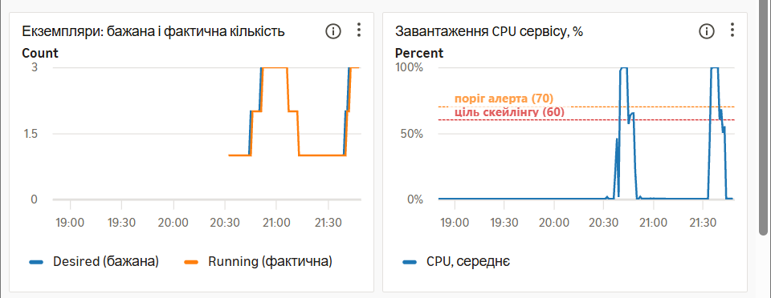
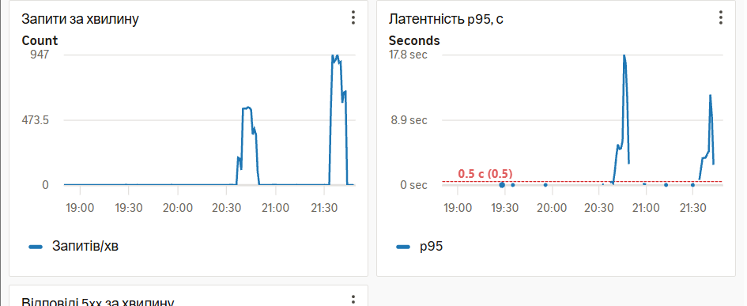

# Автоматичне масштабування і панель моніторингу

## Обрані параметри (Terraform: `terraform/autoscaling.tf`)

| Параметр | Значення | Де в коді |
|---|---|---|
| Мінімум екземплярів | 1 | `var.min_capacity` |
| Максимум екземплярів | 3 | `var.max_capacity` (за умовою ≤ 4) |
| Метрика | `ECSServiceAverageCPUUtilization` (середній CPU по всіх екземплярах сервісу) | `aws_appautoscaling_policy.cpu` |
| Тип політики | Target tracking: AWS сам тримає метрику біля цілі | `TargetTrackingScaling` |
| Цільове значення | 60 % | `var.cpu_target` |
| Cooldown на додавання | 60 с | `var.scale_out_cooldown` |
| Cooldown на вилучення | 300 с | `var.scale_in_cooldown` |

### Чому 60 %
Ціль 60 % залишає запас ~40 % CPU, який поглинає стрибок трафіку, поки новий екземпляр ще піднімається (на Fargate це 1–2 хвилини: завантаження образу, старт застосунку, health check). Якщо поставити 90 %, екземпляр уже «в стелі» до того, як з'явиться допомога, і латентність різко зростає. Якщо поставити 30 %, сервіс масштабується без потреби і платимо за простій. Для задачі Fargate з 0,25 vCPU, де CPU споживає серіалізація JSON і робота з драйвером бази, 60 % розумний компроміс.

### Чому максимум 3
Обмеження лаби ≤ 4 і економія кредитів. Також база `db.t4g.micro` має обмежену кількість підключень (застосунок відкриває нове підключення на кожен запит), тому нескінченно додавати екземпляри не можна: вузьким місцем стане база.

## Що таке cooldown (період стабілізації)

Cooldown це пауза після масштабування, протягом якої політика не виконує наступну дію того самого напряму. Причина: ефект від нового екземпляра проявляється не одразу. Він стартує ~1–2 хв, а метрика CPU усереднюється ще хвилину. Без паузи система дивиться на ще «гарячу» метрику і додає зайвих екземплярів.

**Що буде, якщо cooldown = 0:**
- *Scale-out = 0*: на кожну хвилину високого CPU система додає ще екземпляр, поки попередні ще стартують. Одразу доходимо до максимуму, хоча вистачило б одного-двох, і платимо зайве.
- *Scale-in = 0*: щойно CPU трохи просів (наприклад, між хвилями трафіку), екземпляр вилучається, CPU на решті знову зростає, і додається новий. Це *flapping*: екземпляри постійно з'являються і зникають, запити, що були на вилученому екземплярі, обриваються або сповільнюються.

Тому scale-out cooldown короткий (60 с, бо краще швидко реагувати на пік), а scale-in довгий (300 с, бо вилучати обережно).

## Панель моніторингу (Terraform: `terraform/monitoring.tf`, ресурс `aws_cloudwatch_dashboard.main`)

Назва дашборда: `laptops-autoscaling`. П'ять графіків:

1. **Екземпляри**: `DesiredTaskCount` (скільки хоче політика) і `RunningTaskCount` (скільки реально працює), простір імен `ECS/ContainerInsights`. Метрики з'являються, бо в `aws_ecs_cluster` увімкнено `containerInsights`.
2. **CPU**: `CPUUtilization` (`AWS/ECS`), з лініями цілі 60 % і порога алерта 70 %.
3. **Запити за хвилину**: `RequestCount`, статистика Sum, період 60 с (`AWS/ApplicationELB`).
4. **Латентність p95**: `TargetResponseTime`, статистика p95.
5. **Відповіді 5xx**: `HTTPCode_Target_5XX_Count`, Sum.

### Знімки з позначеними моментами

Прогін №1: N = 40, кеш обходиться, старт ≈ 22:39:45 (час за Києвом). **Увага: вісь часу на скріншотах CloudWatch у UTC, тобто Київ = UTC + 2 год** (20:40 на осі = 22:40).

| Момент | Час (Київ) | Де на дашборді |
|---|---|---|
| Початок навантаження (наростання) | ≈ 22:39:45 | графік 3 «Запити за хвилину» піднімається |
| Початок сталого етапу | ≈ 22:42:15 | |
| CPU перетнув ціль 60 % (і поріг алерта 70 %) | ≈ 22:40–22:41 | графік 2: CPU = 97–100 % |
| Desired став 2, потім 3 (рішення політики) | ≈ 22:44, ≈ 22:45 | графік 1, лінія Desired |
| Running став 2, потім 3 (нові екземпляри обслуговують) | ≈ 22:45, ≈ 22:46 | графік 1, лінія Running |
| Кінець тесту | 22:49:15 | запити/хв падають до 0 |
| Вилучення: 3 → 2 | ≈ 23:05 | графік 1 |
| Вилучення: 2 → 1 (мінімум) | ≈ 23:12 | графік 1 |

Скріншот також містить другий прогін (з кешем) близько 23:34–23:44: масштабування 1 → 2 → 3 о ≈ 23:38–23:40, пік запитів 947/хв проти 564/хв у першому прогоні, пік p95 ≈ 12 с проти 17,8 с.

> Точні часи зчитано з графіків (наведення курсору на лінію дає точку з часом); значення з «≈» округлені до хвилини.

### Чому між перетином порогу і появою екземпляра минає час

1. **Метрика запізнюється.** CloudWatch збирає CPU раз на хвилину і усереднює; політика target tracking вимагає кілька послідовних точок над порогом (щоб не реагувати на разовий сплеск), тому спрацьовує через ~3 хвилини після перетину.
2. **Екземпляр піднімається не миттєво.** Fargate має створити task, завантажити образ з ECR, запустити контейнер, а ALB має кілька разів успішно перевірити `/health` (`healthy_threshold = 2` по 30 с) і лише потім пускає трафік. Разом ~1–2 хвилини.

### Чому вилучення відбувається значно пізніше за падіння навантаження

Це свідома асиметрія: помилка в бік «зайвий екземпляр» коштує копійки, а помилка «вилучили зарано» призводить до нової хвилі перевантаження. Тому scale-in вимагає, щоб метрика була нижче цілі довго (target tracking дивиться ~15 хвилин поспіль) і додатково діє `scale_in_cooldown = 300 с`. У нашому прогоні екземпляри повернулись до мінімуму лише через ≈ 23 хвилини після кінця тесту (кінець 22:49, мінімум ≈ 23:12). Крім того, перед вилученням ALB має 30 с (`deregistration_delay`) дати завершитися активним запитам.
